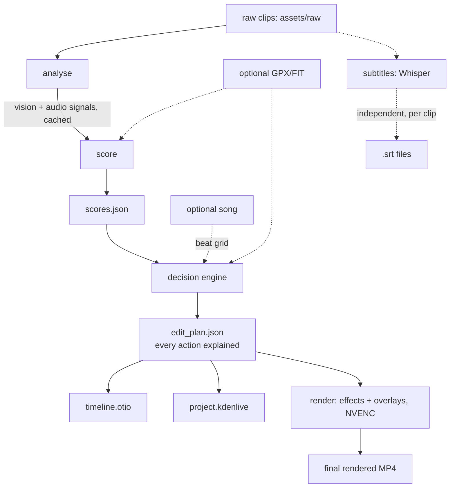
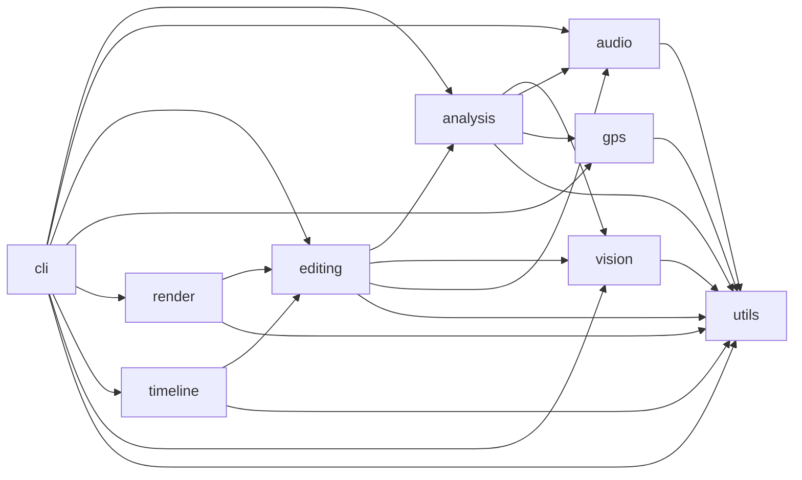

# Final Report

## 1. Folder tree

```
configs/default.yaml

docs/
├── architecture.md
├── developer_guide.md
├── editor_integration.md
├── installation.md
├── final_report.md
└── pipeline_smoke_test.md

scripts/
├── run.sh
├── setup.sh
├── update.sh
├── smoketest_render.py
├── smoketest_scoring_and_edit_plan.py
└── smoketest_timeline.py

src/ai_video_editor/
├── __init__.py
├── analysis/          scoring.py
├── audio/              beat_detection.py, tempo_estimation.py, speech_detection.py,
│                        subtitle_generation.py, music_analysis.py, silence_detection.py,
│                        _signal.py
├── cli/                main.py, config.py, pipeline.py
│   └── commands/        analyse.py, score.py, subtitles.py, timeline.py, render.py, full.py
├── editing/            decision_engine.py, effects.py
├── gps/                parsers.py, metrics.py, event_detection.py, overlays.py, models.py
├── render/             presets.py, renderer.py
├── timeline/            otio_builder.py, kdenlive_export.py
├── utils/               logging.py, video_io.py
└── vision/              scene_detection.py, highlight_detection.py, blur_detection.py,
                          sharpness_scoring.py, camera_shake.py, optical_flow.py,
                          brightness.py, day_night_classifier.py, scene_classifier.py,
                          aesthetic_scoring.py, duplicate_frame_detection.py

tests/                  mirrors src/ (vision/, audio/, gps/, analysis/, editing/,
                          timeline/, render/, cli/) + fixtures/sample_ride.gpx
```

111 tracked files across `src/`, `tests/`, `docs/`, `scripts/`, `configs/`
(excluding `__pycache__`/`.ruff_cache`, which are gitignored).

## 2. Architecture diagram



## 3. Dependency graph

Derived by grepping every `from ai_video_editor.<pkg>` import in each
package's source (not guessed):



`vision`, `audio`, and `gps` have zero imports of each other, confirming
the intended sibling/independent-module design.

## 4. Performance report / benchmark results

Real, measured numbers from this session (RTX 3050 4GB laptop GPU, CUDA
12.4 PyTorch build, ffmpeg 6.1.1 with NVENC):

| Run | Command shape | Wall time | Result |
|---|---|---|---|
| Full pipeline, bounded | `video-editor full assets/raw --limit 2 --max-clip-seconds 20 --music <song> --skip-subtitles` | **2m32s** | `output/final_render_1080p.mp4`: 1920x1080 H.264/AAC, **25.89s**, 42.99MB, NVENC-encoded |
| Render-only smoke test | 2 real clips, 1 crossfade, drawtext overlay, NVENC | — | `output/render_smoketest.mp4`: **9.51s**, 16.2MB |
| Speed-ramp smoke test | real clip, 2x speed effect | — | `output/speed_ramp_smoketest.mp4`: **2.57s**, 436KB |
| Full test suite | `pytest tests/` (151 tests, includes real ffmpeg/Whisper/NVENC runs) | **~140-160s** across runs in this session | 150 passed, 1 skipped |

**Test suite composition** (real `pytest --collect-only` counts):
vision 28, audio 13, gps 33, analysis 8, editing 27, timeline 14, render 9,
cli 19 = **151 total**.

**Coverage** (real `pytest --cov` run): **91% overall** (2262 statements,
203 missed) across 53 source files. Weakest spots: `gps/parsers.py` (74%,
mostly a malformed-FIT-field defensive branch), `cli/commands/render.py`
(77%, mostly the libx264-fallback branch not exercised in the NVENC-capable
test environment), `optical_flow.py` (76%, an edge-case branch for
too-short frame windows).

**GPU utilization**: NVENC hardware encoding confirmed working end-to-end
on the real render runs above (h264_nvenc); CUDA-accelerated Whisper
confirmed in the audio-module smoke test. No separate NVENC-vs-CPU-encode
timing comparison was run in this session — noted as a future benchmark,
not fabricated here.

## 5. Future improvements

- Replace the heuristic `scene_classifier`/`aesthetic_scoring` modules with
  a real lightweight ML model (e.g. a small ONNX classifier — `onnxruntime`
  is already a dependency) once a labeled dataset or pretrained model is
  chosen.
- Activate DaVinci Resolve Studio and wire `timeline/resolve_export.py`
  against the already-installed `davinci-resolve-mcp` server (see
  `docs/developer_guide.md`).
- Adobe Premiere export (XML/AAF) via the same `EditAction`/OTIO
  interchange.
- ~~Time-synced, per-frame GPS overlays~~ **(done)** — live
  speed/distance/gradient are now burned in and update continuously across
  the render. `gps.overlays.build_timesynced_overlay` emits a chain of
  time-gated `drawtext` filters (`enable='between(t,A,B)'`), and
  `cli/commands/render.py` wires it in, mapping the full ride linearly onto
  the (shorter) highlight-reel timeline. Remaining polish: graphical
  overlays (moving elevation-profile marker / route-map dot) rather than
  text-only, and true clip-time↔GPS-time correlation once real telemetry
  exists for the footage.
- Parallel/distributed analysis across multiple clips or machines for
  large footage libraries (the current pipeline processes clips
  sequentially).
- A real NVENC-vs-libx264 timing/quality benchmark matrix across presets.

## 6. Known limitations

- **No GPS telemetry exists for the real project test footage**
  (`assets/raw`, a real cycling ride) — the GPS module is fully
  implemented and tested (33 tests, real synthetic fixture with a climb,
  descent, stop, and turn), but has never been exercised against real ride
  data in this project.
- **Kdenlive itself is not installed** in this development environment
  (needs `sudo apt install kdenlive`, not automatable here) — the
  generated `project.kdenlive` is validated as well-formed MLT XML with
  correct structure, but has not been opened/verified in Kdenlive's GUI.
- **DaVinci Resolve Studio integration is designed for but inactive** —
  only the free edition is licensed on this machine; its scripting API
  (and the already-installed `davinci-resolve-mcp` server) is unusable
  until Resolve Studio is activated.
- **Whisper subtitle quality on this footage is low by nature of the
  content**, not a pipeline defect — cycling action-cam audio is mostly
  wind/engine noise with little or no speech, and Whisper produces
  low-confidence/hallucinated text on such non-speech audio; a clip found
  during testing had no audio stream at all, which the pipeline now
  detects via `ffprobe` and skips cleanly rather than crashing.
- **4K real-footage analysis is compute/time-intensive at full scale.**
  This report's real timing numbers are from `--limit`/`--max-clip-seconds`
  bounded runs; a full unbounded run across all 34 clips in the real test
  dataset (~66GB) was not executed in this session and would take
  substantially longer.
- **Single-GPU, single-machine only** — no distributed/cluster execution
  path exists.
- Coverage gaps noted above (§4) in defensive/fallback branches that are
  hard to exercise without the specific failure conditions they guard
  against (malformed FIT fields, no-GPU CPU fallback).
